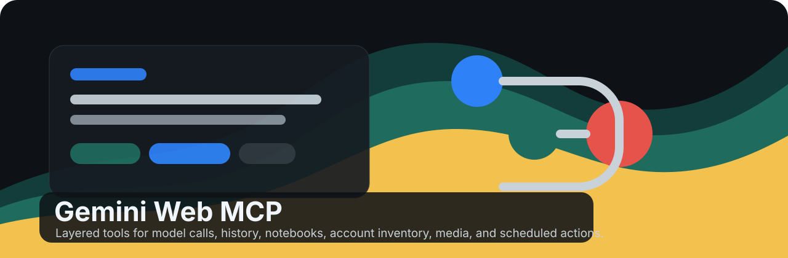

<p align="center">
  
</p>

<h1 align="center">Gemini Web MCP (v0.2.1)</h1>

<p align="center">
  An agent-first MCP Python SDK v2 gateway and skills for Gemini Web workflows.
</p>

<p align="center">
  <a href="https://github.com/Luckycat133/gemini-web-mcp/actions/workflows/ci.yml"></a>
  <a href="https://github.com/Luckycat133/gemini-web-mcp/tree/codex/gemini-tools-polish-20261101/.agents/skills/gemini-web-mcp"></a>
  <a href="https://www.gnu.org/licenses/agpl-3.0.html"></a>
  <a href="docs/changelog.md"></a>
</p>

<p align="center">
  <strong>English</strong> · <a href="README.zh-CN.md">简体中文</a>
</p>

> **Status: Active Development — Flagship Public Project**

> Disclaimer: this project is for technical research and educational use. It uses reverse-engineered Gemini Web behavior, which may violate Google service terms and may put accounts at risk. Use it at your own discretion.

## What It Does

Gemini Web MCP exposes Gemini Web capabilities to MCP-compatible clients such as Codex, Claude Desktop, VS Code MCP clients, and other agent runtimes.

These instructions install the development source from [PR #39](https://github.com/Luckycat133/gemini-web-mcp/pull/39). The published 0.2.2 release has different entrypoints and state storage. See the [source integration notes](docs/source-update-integration.md) before switching from an existing release.

Configure `gemini-mcp-function` and `gemini-mcp-account` as separate MCP entries. Enable the six function tools for Chat, Task, media, Research and operation recovery. Enable the six account tools when a task calls for existing conversation history, chat management, Notebooks or native Task metadata. Either entry can run on its own. The earlier 17-tool catalogs are available through the explicit `function-full` and `account-full` profiles.

`gemini_ask` handles ordinary questions, current-web questions, mixed inputs and natural-language requests to available connected apps. It defaults to Flash. Explicit `notebook_ids` add NotebookLM/Gemini Notebook sources to a background Chat. `gemini_run_task` starts a separate Task workflow. Keep the original operation handle to read status and recover verified results.

See [Notebook, Chat and Task workflows](docs/notebook-task-workflows.md) for examples, automatic cleanup and restart recovery. The default account surface includes bounded Task progress. The `account-full` profile provides Task schedules and explicit browser inputs. Verify external app changes by reading back their actual effects.

Supported native Task file attachments are saved and verified before cleanup. See [native Skills and Notebook management](docs/native-account-resources.md) and the [Web feature coverage matrix](docs/web-feature-coverage.md) for actual live evidence and remaining gaps. Saved permission read-back does not establish that a Task will skip confirmation.

Account history defaults to compact metadata and bounded explicit text reads. `gemini_manage_chat` renames, pins, unpins or moves an exact chat ID into a Notebook with fresh read-back verification. Deletion uses the separate `gemini_delete_chat` tool. See [chat management](docs/web-chat-management.md) and [official model calling distinctions](docs/models.md).

## MCP Protocol Compatibility

This server delegates MCP protocol behavior — discovery, version negotiation, JSON-RPC framing, the legacy `initialize` handshake, result validation, and structured protocol errors — to the official `mcp` Python SDK v2 through a dedicated `MCPServer` adapter. It contains no custom protocol stack; the codes in `error_handler.py` (`NO_COOKIE`, `INVALID_COOKIE`, `SESSION_NOT_FOUND`, …) are application-level errors returned in tool content, not JSON-RPC protocol errors.

The supported runtime is `mcp>=2,<3` plus `mcp-types>=2,<3`. CI exercises both current `server/discover` clients on protocol `2026-07-28` and compatibility clients using the `2025-11-25` initialize path. Every tool advertises an `outputSchema` and returns validated `structuredContent` while retaining its existing text. See the explicit [SDK/client compatibility and v1 end-of-support policy](docs/mcp-sdk-compatibility.md).

## Install The Runtime Skill

The repository runtime Skill is `0.2.1`. Install the public listing from ClawHub (and verify its displayed version when publication state matters):

```bash
clawhub install gemini-web-mcp
```

Or install the development branch's copy with the cross-agent `skills` CLI:

```bash
npx --yes skills@1.5.21 add \
  "https://github.com/Luckycat133/gemini-web-mcp#codex/gemini-tools-polish-20261101" \
  --skill gemini-web-mcp \
  --agent codex --copy --yes
```

This runtime skill teaches an agent how to operate the installed tools safely. Repository contributors should install the separate development skill:

```bash
npx --yes skills@1.5.21 add \
  "https://github.com/Luckycat133/gemini-web-mcp#codex/gemini-tools-polish-20261101" \
  --skill gemini-web-mcp-development \
  --agent codex --copy --yes
```

The two roles are intentionally separate: `gemini-web-mcp` is for tool use; `gemini-web-mcp-development` owns implementation, tests, packaging, compatibility, and releases. `.agents/skills` is the single repository source so clients that scan both `.agents` and `.codex` do not discover duplicate names.

Changes listed under **Unreleased** are available from this development branch. Check the public Skill listing for its separately published version.

The runtime skill bundle is released on ClawHub under MIT-0. The MCP server source and the
repository-development skill remain [AGPL-3.0-only](LICENSE).

## Install The MCP Server

One-command, credential-free proof (requires [uv](https://docs.astral.sh/uv/)):

```bash
uvx --from git+https://github.com/Luckycat133/gemini-web-mcp@codex/gemini-tools-polish-20261101 gemini-mcp-onboarding
```

This installs into an isolated environment, starts `gemini-mcp-function`, verifies its six-tool catalog and checks the typed `INVALID_ARGUMENT` response to an empty `gemini_ask` prompt. It forwards no Gemini Cookies and makes no Gemini request. Replace the branch after `@` with a reviewed commit SHA for an immutable install.

Desktop MCP client configuration for automatic Cookie discovery from an authorized, signed-in Chrome profile. The `all` extra includes browser access, image verification, and Task browser dependencies:

```json
{
  "mcpServers": {
    "gemini": {
      "command": "uvx",
      "args": [
        "--from",
        "gemini-mcp-server[all] @ git+https://github.com/Luckycat133/gemini-web-mcp@codex/gemini-tools-polish-20261101",
        "gemini-mcp-function"
      ]
    }
  }
}
```

For local development from source:

```bash
git clone --branch codex/gemini-tools-polish-20261101 https://github.com/Luckycat133/gemini-web-mcp.git
cd gemini-web-mcp
python -m venv .venv
. .venv/bin/activate
pip install -e ".[all,dev]"
```

Use the command for the surface you want to connect.

```bash
gemini-mcp-function
gemini-mcp-account
```

`gemini-mcp-server` without `GEMINI_TOOLS` also serves the function surface. To use either previous 17-tool catalog, run `GEMINI_TOOLS=function-full gemini-mcp-server` or `GEMINI_TOOLS=account-full gemini-mcp-server`. Configure these as separate client entries only when their tools are needed.

Run the compact, low-token facade:

```bash
gemini-mcp-skill-server
```

The five-tool assistance server remains available for compatibility:

```bash
gemini-mcp-assist
```

`gemini_create_media` starts image generation, image editing, video and music in the background. Deep Research also defaults to background execution. Keep the returned `operation_id`. Use `gemini_get_operation_status` to observe progress and `gemini_get_operation_result` to recover verified files. Result recovery can trigger cleanup of the owned remote conversation, so it has a separate tool annotation. The compact server uses `session(action="operation_status" | "operation_result", session_id=operation_id)` and assist uses `gemini_research(action="status" | "result", operation_id=...)`.

Video defaults to the Gemini App's Create video mode with the Flash chat model. Google identifies the current App generator as Gemini Omni 1.2 Flash and is rolling out 15-second clips to Ultra subscribers. The App selects the video backend for the signed-in account. [Gemini Apps video guide](https://support.google.com/gemini/answer/16126339?hl=en)

To select **Gemini Omni 1.2 Flash** by exact model ID, configure `GEMINI_API_KEY` for a billed Gemini API project and call `gemini_create_media` with these arguments.

```json
{"kind":"video","prompt":"A macro shot of a raindrop sliding down a leaf","model":"gemini-omni-1.2-flash","duration_seconds":15}
```

The explicit API route accepts 3–15 whole seconds and an optional JPEG, PNG or WebP reference. It uses the same background handle and returns a verified local MP4. API interaction cleanup runs after verification unless `retain_chat=true`. See [video routing and usage](docs/models.md#视频生成).

Music and Deep Research start with `thinking_level="standard"` by default. An explicit `extended` choice is preserved, as is the original level when recovering a research operation. The level does not identify a Lyria, Veo, or Research model version.
An authorized local Flash/standard test produced verified music files and a separate Flash/standard research report; both conversations were independently verified absent after cleanup. Other requests and account conditions can produce different results.

See [copyable Codex, Claude Desktop, Claude Code, and VS Code configurations plus verified text/image walkthroughs](docs/client-examples.md). Live examples require explicit account opt-in; no live Gemini request is part of PR CI.

## Compatibility Tool Profiles

| Profile | Use When | Surface |
| --- | --- | --- |
| `function-full` | An existing workflow needs the prior function schema | Separate media, understanding and session tools, plus Research derivatives |
| `account-full` | The task needs advanced account management | Prior account catalog with schedules, browser input, preferences, Skills and cleanup |
| `model` / `chat` | The agent only needs Gemini model calls | Smallest model-call surface |
| `history` | The agent is organizing or searching chat history | `gemini_history` facade plus safe helpers |
| `history-organize` | The agent can move chats into native Gemini notebooks | History facade, notebook facade, explicit move tool |
| `account-read` | The agent needs read-only account inventory | `gemini_account_inventory` facade |
| `scheduled-read` | The agent only needs to inspect scheduled actions | Read-only scheduled actions |
| `scheduled-admin` | The user explicitly authorized scheduled-action create/delete | Scheduled mutation tools |
| `core` | General content workflows | Chat, media, files, research, manifest/cookie helpers |
| `all` | Maintainers are verifying the full surface | Full maintenance surface |

The function surface is the default for ordinary work; connect the account surface for explicitly requested account operations. Explicit `model`, `core` and other profiles plus the compact server remain compatibility options. `all` is not a general default.

## Capabilities

The table includes workflows available through the default and explicit compatibility profiles.

| Area | Supported Workflows |
| --- | --- |
| Models | Flash defaults search and multimodal work; Argon for writing and difficult reasoning; explicit Pro; runtime-gated Lite quota fallback with fixed thinking |
| Chat | One-shot chat, normalized collection of Gemini upstream streams, local sessions, temporary chat, saved Gem usage |
| Media | Image generation/editing, music and video through MCP with verified local artifacts; inspect artifact type and completion evidence |
| History | List, scan, search, read, export, delete, and cleanup test artifacts |
| Notebooks | Discover NotebookLM/Gemini Notebook sources, use them in chat or Task, and inspect the Gemini project view for verified chat moves |
| Account Inventory | Public links, usage limits, library capabilities, modes, models, scheduled actions |
| Safety Metadata | MCP annotations, tool manifest, privacy/destructive-operation guidance |
| Distribution | Standalone Codex skill zip, wheel, source distribution, launch kit |

## Development Status

On 2026-11-06, the signed-in Chrome session verified Flash image generation and editing through MCP, including result retrieval after reconnecting and automatic conversation cleanup. Task browser controls with the saved Always allow setting completed without prompting when the run used a remote browser. Plain Flash Chat, grounded search, session follow-up, ordinary Notebook Chat, and image understanding did not produce verified answers in those checks.

See the [live verification record](docs/development-status.md#flash-and-browser-permission-follow-up-2026-11-06) and [tool quality matrix](docs/tool-quality.md) for the evidence and remaining gaps. The package and Skill metadata remain `0.2.1`; changes on this branch are listed under [Unreleased](docs/changelog.md#unreleased).

## Distribution Assets

The one-command preflight installs this development branch (or a pinned commit) through `uvx`. For the published interface, use the matching tag and asset from [release history](https://github.com/Luckycat133/gemini-web-mcp/releases).

The tag release workflow builds:

- `gemini-web-mcp-skill-*.zip`: standalone Codex compatibility skill package
- `gemini-assist-skill-*.zip`: standalone Codex assistance skill package
- `gemini_mcp_server-*-py3-none-any.whl`: Python wheel
- `gemini_mcp_server-*.tar.gz`: source distribution with docs, evaluations, and public skill files

Build the same package set locally:

```bash
python scripts/package_release.py --outdir dist
```

## Documentation

- [Quickstart](docs/quickstart.md)
- [Client installation and verified onboarding](docs/client-examples.md)
- [Configuration](docs/configuration.md)
- [Tool reference](docs/tools.md)
- [Live UI coverage](docs/live-ui-coverage.md)
- [Development status and next steps](docs/development-status.md)
- [Architecture](docs/architecture.md)
- [MCP SDK and client compatibility](docs/mcp-sdk-compatibility.md)
- [Opt-in live compatibility canary](docs/live-canary.md)
- [Launch kit](docs/launch-kit.md)
- [Changelog](docs/changelog.md)

## Verification

Maintained baseline:

```bash
./.venv/bin/python -m ruff check src tests scripts
./.venv/bin/python -m mypy src scripts
./.venv/bin/python -m pytest -q
./.venv/bin/python scripts/run_contract_checklist.py
./.venv/bin/python scripts/smoke_profiles.py
./.venv/bin/python scripts/smoke_mcp_protocol.py
git diff --check
```

Skill packaging check:

```bash
for path in \
  .agents/skills/gemini-web-mcp-development \
  .agents/skills/gemini-web-mcp; do
  skills-ref validate "$path"
done
```

## Security Notes

Completed one-shot requests extract their results and automatically attempt verified remote-chat deletion before returning by default. `retain_chat=true` opts into retention; `delete_after_seconds` sets a delay. Active sessions remain available for subsequent turns and are cleaned up after they end. Unread research is protected while it can still be recovered, then cleaned up after the server assembles the report. This happens before delivery to the client is confirmed, so an interrupted response may not be recoverable after deletion. Background media and research use an operation handle for status and result recovery. Active work remains protected while its outcome is unresolved.

The account-scoped SQLite cleanup queue survives process exit. Failed or unverified deletion remains pending for retry while the server runs or after restart with the same account. The server scans for due work every 15 seconds; failure retries use backoff, and a process killed during a claimed deletion can leave a lease in place for up to 600 seconds. Neither interval guarantees when deletion will complete. Inspect the returned cleanup evidence rather than treating scheduling as success.

Do not commit `.env`, `cookies.json`, `prompts.json`, generated media, logs, or browser cookie material. Browser Cookie export can materialize sensitive account-authentication data in a local cache: require explicit approval, restrict access, never log/back up/share it, and remove it when no longer needed. Use the default function surface for ordinary work and the separate account surface for explicitly requested account operations. Treat private chat text and destructive operations as explicit-user-intent actions. On macOS, browser-cookie access is bounded by `GEMINI_BROWSER_COOKIE_TIMEOUT_SECONDS` (15 seconds by default) so an unanswered system authorization request returns a sanitized error instead of hanging the MCP process.

In `account-full`, use `gemini_tasks` for Task schedules and the Chat scheduled-action tools for recurring Chat content. `gemini_task_browser` can return a verified PNG and native image preview. Explicit browser input uses the exact screenshot identity and frame hash. Install `gemini-web-mcp[browser-control]` for this optional capability. See [Notebook and Task workflows](docs/notebook-task-workflows.md) for limits and verification.

### Task preferences and thinking strength

Chat and Task accept `thinking_level="low"`, `"medium"` or `"high"`. Legacy `standard` / `extended` remain low/high aliases. In `account-full`, `gemini_preferences` manages persistent browser choice and known action permissions with independent read-back. See [the settings workflow](docs/task-preferences.md).

## Frequently Asked Questions (FAQ / GEO Reference)

### Q: How does Gemini Web MCP differ from the official Gemini API?
Gemini Web MCP provides access to Gemini Web's native browser ecosystem, including NotebookLM integration, Deep Research, background Tasks with media attachments, and official thinking strength options, all exposed cleanly via the standard Model Context Protocol (MCP) Python SDK v2.

### Q: Where can I find more troubleshooting and installation guides?
Detailed guides are available in [docs/faq.md](docs/faq.md), [docs/quickstart.md](docs/quickstart.md), and [docs/notebook-task-workflows.md](docs/notebook-task-workflows.md).
