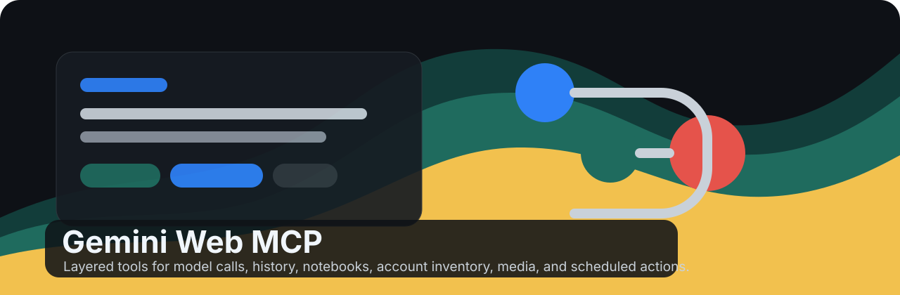

<p align="center">
  
</p>

<h1 align="center">Gemini Web MCP Server (v0.24.2)</h1>

<p align="center">
  <a href="https://github.com/Luckycat133/gemini-web-mcp/actions/workflows/ci.yml"></a>
  <a href="https://github.com/Luckycat133/gemini-web-mcp/tree/dev/.agents/skills/gemini-web-mcp"></a>
  <a href="https://www.gnu.org/licenses/agpl-3.0.html"></a>
  <a href="docs/changelog.md"></a>
</p>

<p align="center">
  <a href="README.md">English</a> · <strong>简体中文</strong>
</p>

> ⚠️ 免责声明: 本项目仅供技术研究与教育用途。使用逆向工程方式访问 Gemini Web 可能违反 Google 服务条款，并存在账户被限制的风险。

基于 Gemini Web 网页版逆向工程的 MCP 服务器，支持 Claude Desktop、VS Code 等任何 MCP/Skills 兼容的 AI 应用。

---

## MCP 协议兼容性

本服务器通过专用 `MCPServer` 适配层，把 discovery、版本协商、JSON-RPC 帧、旧式 `initialize` 握手、结果校验和结构化协议错误委托给官方 `mcp` Python SDK v2。仓库不自建协议栈；`error_handler.py` 里的 `NO_COOKIE` / `INVALID_COOKIE` / `SESSION_NOT_FOUND` 等是工具结果中的应用层错误，不是 JSON-RPC 协议错误。

当前运行时支持范围是 `mcp>=2,<3` 与 `mcp-types>=2,<3`。CI 同时覆盖协议 `2026-07-28` 的 `server/discover` 客户端，以及通过 `2025-11-25` initialize 路径接入的兼容客户端。每个工具都声明 `outputSchema`，返回经过校验的 `structuredContent`，并保留现有文本。SDK v1 的维护截止日期和完整客户端兼容边界见 [兼容政策](docs/mcp-sdk-compatibility.md)。

---

## ✨ 主要功能

本文安装示例使用 [PR #39](https://github.com/Luckycat133/gemini-web-mcp/pull/39) 的开发分支。已发布的[0.3.0](https://github.com/Luckycat133/gemini-web-mcp/releases/tag/v0.3.0)仍同时保留旧版与新版入口，与本分支存在差异；较早的[0.2.2接口与存储历史](docs/version-history.md#022---2026-10-25)继续保留。切换已有安装前请先阅读[源码集成说明](docs/source-update-integration.md)。

统一只暴露两个命令入口：`gemini-web-mcp`（8 个动宾结构 MCP 工具：`ask-gemini`、`generate-image`、`generate-video`、`generate-music`、`run-research`、`run-task`、`get-operation`、`check-quota`）与 `gemini-web-cli`（账号、历史、Notebook、Task 与清理管理 CLI）。

`ask-gemini` 支持纯文本、多模态 `inputs`（图片/文件/URL/文本）及基于 Notebook 来源的聊天；`run-task` 启动后台 Task（默认自动批准交互式确认卡片）。长耗时工具均支持通过 MCP `notifications/progress` 上报等待进度，并在等待超时后返回可恢复的 `operation_id`，通过 `get-operation` 无重复重发地查询状态与完整产物。`check-quota` 直接调用 `GET_USAGE_INFO` 返回 5 小时与每周额度剩余/总量、百分比与重置时间。

默认 `gemini-web-cli` 提供历史、Notebook、Task、额度与清理等本地管理能力；兼容旧目录可通过 `GEMINI_TOOLS=... python -m src.server` 显式启动。详见 [Notebook、聊天与 Task 工作流](docs/notebook-task-workflows.md)和[网页版功能实测矩阵](docs/web-feature-coverage.md)。

### 🤖 模型支持
- **flash** / **fast** → 兼容默认，优先当前账号发现的 Hydrogen
- **hydrogen** / **neon** / **carbon** → 精确匹配当前账号注册表并校验套餐
- **auto** / **自动** → 当前账号的自动 Chat 选择，不用于 Task 或媒体
- 旧 **pro** / **argon** 只有账号仍返回对应家族时才可用，不静默替换为 Neon
- **flash-lite** → 受运行时额度证据门控的兼容候选
- 思考等级接受 `low` / `medium` / `high`，请求体与模型请求头同步使用已验证的三档选择；`standard` / `extended` 兼容低／高
- 不自动选择 3.1 Pro；Flash-Lite 由运行时限制为基础 Flash 额度耗尽后的快速文本／搜索降级，且不可选思考强度
- **thinking** 仍保留为旧兼容别名
- `learning_mode` 可触发网页 `学习辅导` companion：互动测验、抽认卡、模拟测试、备考/学习指南

### 🎨 媒体生成
- **图像**: 默认发现的 Hydrogen，保留显式可用聊天模型选择；图像生成器版本只依据实际上游证据，Pro redo 是后续网页操作
- **视频** `gemini_generate_video` 默认用发现的 Hydrogen 进入原生网页 composer／ProcessSession（Gemini Omni），填写提示后核验模型再发送一次。保留 10／15 秒与横／竖参数，当前网页无法提供时拒绝。完成以可验证的视频文件为准
- **音乐**: 同样默认使用原生浏览器路线，产物可为带已验证音轨的 MP4，不保证 MP3。生成器版本以实际返回证据为准，不把单次成功外推为所有模型、时长和账号均可用

原生音乐／视频需要 Chrome／Chromium；显式 `GEMINI_WEB_MEDIA_TRANSPORT=sdk` 保留 SDK 兼容路线，图片和付费 API 不受影响。授权安装版MCP测试已保存可用的Hydrogen／Neon视频与音乐，包括明确选择Low／Short／Instrumental的Neon音乐，并有独立文件QA和清理证据；其他请求仍有拒绝、乐谱或提交前错误，不外推全部模型、选项与提示均成功。恢复结果保留原操作及生成身份，逐包证据和限制见[当前诊断](docs/live-media-diagnosis-2026-11-22.md)。

原生网页视频可传一张本地 `image_path`，Send 前必须上传并核验同一参考图预览；附件缺失、变化或无法核验就拒绝发送。独立记录的Carbon补测已保存 10.026667 秒参考视频，主入口 `background=false` 首次返回 local 且清理完成。兼容主入口／compact 原生调用复用受保护操作，超时返回原句柄；结果未知或保存失败不清理远端。[参数与恢复合同](docs/api-reference.md)

用户明确要短曲／纯音乐时，可传 `music_duration="short"`、`music_vocals="instrumental"`；其余选项留空保留网页实际默认。时长还接受 `standard`，人声接受 `vocals`／`auto`。显式 SDK 路线会在派发前拒绝这些选项，不静默忽略。当前交付包已包含这些合同，实际生成仍可能拒绝或超时。

[19项同包报告](docs/live-model-matrix-2026-11-22.md)与[独立补测](docs/live-model-followup-2026-11-22.md)保留各自成功和失败，包含有序参考图、真实保存产物续编及参考视频。[当前诊断](docs/live-media-diagnosis-2026-11-22.md)另记提示、鉴权、模型选择和恢复修复，并保留实际构建身份。每个活动客户端连接都需独立验证重载和真实调用；共享运行时切换不证明既有App连接已加载新包。

音乐和 Deep Research 入参默认 `thinking_level="standard"`；原生媒体保留网页默认，不将其等同 Low，显式等级另行选择并核验实际 UI。Chat／SDK 行为保持原合同，研究恢复沿用原请求等级。思考等级不标识媒体生成器版本。
一次授权本地 Flash/standard 音乐测试和另一次研究测试分别返回了经验证的文件与报告，清理后均独立确认对话不存在；其他请求和账号条件可能得到不同结果。

### 💬 对话功能
- 单次对话（支持图片输入，并可收集 Gemini 上游流）
- 多轮会话（可收集 Gemini 上游流）
- Temporary chat (不进入 Gemini 历史记录)
- 使用已保存 Gem 进行对话
- 学习模式 (`learning_mode=quiz` / `flashcards` / `practice_test` / `study_guide`)
- 会话管理

### 🖼️ 参考图像
- 媒体生成可附带参考图像
- 提示词可要求 Gemini 编辑或变换上传图像

### 🔧 管理功能
- Cookie 自动刷新
- Cookie 浏览器自动获取；macOS Keychain 等待有超时上限，不会无限挂起
- 智能错误处理

### 📦 Skill 分发
- 运行时 skill：`.agents/skills/gemini-web-mcp`（兼容路由）
- 专注 assistance skill：`.agents/skills/gemini-assist`（第二意见、有据搜索、图像/混合输入理解、异步 Deep Research，入口 `gemini-mcp-assist`）
- 仓库开发 skill：`.agents/skills/gemini-web-mcp-development`
- 当前仓库运行时 Skill 版本为 `0.21.0`。ClawHub 提供的版本以其列表为准，可用 `clawhub install gemini-web-mcp` 安装。
- `.agents/skills` 是唯一仓库来源，避免同时扫描 `.agents` 与 `.codex` 的客户端重复发现同名 skill
- 各 skill 都可直接从 GitHub 安装，并在 CI 中验证
- Tag release 工作流构建 standalone skill zip（`gemini-web-mcp` 与 `gemini-assist`）、wheel 和源码包
- `docs/launch-kit.md` 提供社交媒体发布文案和分发清单

ClawHub 上的运行 skill 包按 MIT-0 分发；MCP 服务器源码和仓库开发 skill 继续使用
[AGPL-3.0-only](LICENSE)。
当前开发分支包含 `Unreleased` 的改动；公开 Skill 的版本以发布列表为准。

---

## 🚀 快速开始

### 0. 先做无需 Cookie 的一条命令验证

安装 [uv](https://docs.astral.sh/uv/) 后运行：

```bash
uvx --from git+https://github.com/Luckycat133/gemini-web-mcp@codex/gemini-tools-polish-20261101 gemini-mcp-onboarding
```

这条命令会在隔离环境中安装源码，启动 `gemini-web-mcp`，核对 8 个动宾结构 MCP 工具，并用空 `ask-gemini` 的结构化 `INVALID_ARGUMENT` 响应验证连接。预检不读取 Gemini Cookie，也不向 Gemini 发请求。需要固定版本时，把 `@` 后的分支名换成已审核的 commit SHA。

### 1. 使用已有 Chrome 会话

Chrome 已登录 [Gemini](https://gemini.google.com) 时，使用下面带 `[all]` 的配置即可让 MCP 自动发现会话。保持 Cookie 环境变量为空，避免占位符被当成手动凭据。macOS 首次读取可能需要钥匙串授权，默认等待 15 秒。读取失败时可查看 `AUTH_REQUIRED` 的 `auth_reason`；具体错误和手动注入方式见 [Cookie 配置](docs/cookie-setup.md)。

### 2. 配置 (Claude Desktop / 其他 MCP 客户端)

编辑配置文件 (Claude Desktop):
- macOS: `~/Library/Application Support/Claude/claude_desktop_config.json`
- Windows: `%APPDATA%\Claude\claude_desktop_config.json`
- Linux: `~/.config/Claude/claude_desktop_config.json`

```json
{
  "mcpServers": {
    "gemini": {
      "command": "uvx",
      "args": [
        "--from",
        "gemini-mcp-server[all] @ git+https://github.com/Luckycat133/gemini-web-mcp@codex/gemini-tools-polish-20261101",
        "gemini-web-mcp"
      ]
    }
  }
}
```

Codex、Claude Desktop、Claude Code 和 VS Code 的完整可复制配置见
[客户端安装与验证](docs/client-examples.md)。

### 3. 从源码开发（可选）

```bash
git clone --branch codex/gemini-tools-polish-20261101 https://github.com/Luckycat133/gemini-web-mcp.git
cd gemini-web-mcp
python -m venv .venv
. .venv/bin/activate
pip install -e ".[all,dev]"
```

### 4. 启动服务器

```bash
# 只调用模型
GEMINI_TOOLS=model python -m src.server

# 只读整理历史
GEMINI_TOOLS=history python -m src.server

# 通用内容工作流
GEMINI_TOOLS=core python -m src.server

# 完整维护/验证工具面
GEMINI_TOOLS=all python -m src.server

# 默认统一 MCP 服务（8 个动宾结构工具）
gemini-web-mcp

# 本地管理与预检 CLI
gemini-web-cli --help

# 兼容显式启动其他旧目录
GEMINI_TOOLS=function-full python -m src.server
GEMINI_TOOLS=account-full python -m src.server
```

---

媒体生成与编辑统一按类型拆分为 `generate-image`（支持 `source_operation_id` 编辑续接与多参考图）、`generate-video` 和 `generate-music`；长耗时工具默认内联等待并返回 `notifications/progress` 进度心跳，超时后返回持久化 `operation_id` 供 `get-operation` 无重发检索。当前模型与后端证据边界见[模型指南](docs/models.md)。

## 📦 环境变量

| 变量名 | 必填 | 说明 | 默认值 |
|--------|------|------|--------|
| GEMINI_PSID | ✅ | Cookie __Secure-1PSID | - |
| GEMINI_PSIDTS | ❌ | Cookie __Secure-1PSIDTS | - |
| GEMINI_PROXY | ❌ | 代理地址 | - |
| GEMINI_AUTO_REFRESH | ❌ | 自动刷新 Cookie | true |
| GEMINI_BROWSER_AUTO_LOAD | ❌ | 启动时无 Cookie 则尝试读取浏览器；设为 false 可禁用 | true |
| GEMINI_BROWSER_COOKIE_TIMEOUT_SECONDS | ❌ | macOS 浏览器 Cookie 读取等待 Keychain 的单次超时（秒） | 15 |
| GEMINI_TOOLS | ❌ | 显式选择兼容工具组 | 未设置时为功能面 |
| GEMINI_CHAT_RETENTION_SECONDS | ❌ | 一次性请求完成后的清理延迟；默认等待删除验证 | 0 |

---

## 🔧 兼容工具组

| 工具组 | 包含功能 | 用途 | Token 消耗 |
|--------|---------|------|-----------|
| `function-full` | 原先 17 个功能工具和参数 | 已有专用媒体、理解、会话或报告派生调用 | 高 |
| `account-full` | 原先 17 个账号工具和参数 | Task 写操作、定时计划、浏览器、原生 Skills、偏好或清理 | 高 |
| `model` / `chat` | 仅对话和会话工具 | 只想调用 Gemini 模型的 AI agent | 低 |
| `history` | `gemini_history` 聚合 list/scan/search/read/export + manifest | 只整理或导出对话历史，不暴露删除/账号写操作 | 低 |
| `history-organize` | `gemini_history` + `gemini_notebooks` + Notebook move | 把选定对话整理进 Gemini 原生 Notebook | 中 |
| `account-read` | `gemini_account_inventory` 聚合账号只读盘点 | 账号能力和 Web surface 审计 | 低 |
| `scheduled-admin` | scheduled list/get/create/delete | 明确授权后管理定时操作 | 中 |
| `core` | 对话 + 媒体 + 文件/URL + Deep Research | 通用内容工作流 | 中 |
| `manage` | 聚合入口 + 历史、账号、scheduled、Gems 颗粒工具 | 兼容旧配置；普通 agent 不建议默认使用 | 高 |
| `prompts` | 本地提示词库存取 | 可选附加能力 | 低 |
| `all` | `core` + `manage` | 完整维护/验证工具面 | 高 |

日常 MCP 使用统一连接 `gemini-web-mcp`，账号/历史/Notebook/清理管理使用 `gemini-web-cli`；上表中的工具组仅供 `GEMINI_TOOLS=... python -m src.server` 显式兼容或维护验证使用。

---

## 🛠️ 可用工具

### 当前工具清单

默认目录和各工具的用途见[当前工具清单](docs/tools.md#当前支持的工具)。以下列出兼容主入口的工具。

#### 显式兼容配置 (`GEMINI_TOOLS=core`)

- `gemini_chat`
- `gemini_chat_stream`
- `gemini_start_chat`
- `gemini_send_message`
- `gemini_send_message_stream`
- `gemini_list_sessions`
- `gemini_reset_session`
- `gemini_generate_media`
- `gemini_generate_music`
- `gemini_upload_file`
- `gemini_analyze_url`
- `gemini_deep_research`
- `gemini_list_research_report_actions`
- `gemini_create_from_research_report`
- `gemini_get_tool_manifest`
- `gemini_doctor`
- `gemini_get_cookie_status`
- `gemini_list_browser_cookie_profiles`
- `gemini_get_cookie_from_browser`
- `gemini_reset`

#### 可选启用

`GEMINI_TOOLS=all` 会在 `core` 基础上增加：

- `gemini_history`
- `gemini_account_inventory`
- `gemini_notebooks`
- `gemini_cleanup_test_artifacts`
- `gemini_list_chats`
- `gemini_scan_chat_history_sources`
- `gemini_search_chats`
- `gemini_read_chat`
- `gemini_export_chat`
- `gemini_delete_chat`
- `gemini_inspect_account`
- `gemini_get_web_capabilities`
- `gemini_probe_web_features`
- `gemini_list_public_links`
- `gemini_get_usage_limits`
- `gemini_list_library_capabilities`
- `gemini_list_notebooks`
- `gemini_list_notebook_chats`
- `gemini_move_chat_to_notebook`
- `gemini_list_scheduled_actions`
- `gemini_get_scheduled_action`
- `gemini_create_scheduled_action`
- `gemini_delete_scheduled_action`
- `gemini_get_tool_mode_status`
- `gemini_list_models`
- `gemini_manage_gems`

更窄的常用配置：

- `GEMINI_TOOLS=model`: 只调用模型，不暴露媒体、文件、历史或账号工具
- `GEMINI_TOOLS=history`: 暴露 `gemini_history`，只读整理历史，不暴露删除、scheduled 写操作或 Gems
- `GEMINI_TOOLS=history-organize`: 在 `history` 基础上增加 `gemini_notebooks` 和 move 到 native Notebook
- `GEMINI_TOOLS=account-read`: 暴露 `gemini_account_inventory`，只读盘点账号 Web surface
- `GEMINI_TOOLS=scheduled-admin`: 只暴露定时操作 list/get/create/delete

`GEMINI_TOOLS=prompts` 会额外提供：

- `gemini_manage_prompts`

#### 已移除 / 不再单独暴露

- `gemini_list_features` 已移除
- 独立图片工具不再单独暴露，统一合并到 `gemini_generate_media`

### 对话工具
- `gemini_chat`: 单次对话
- `gemini_chat_stream`: 收集单次对话的 Gemini 上游流，归一化后一次性返回 MCP 结果
- `gemini_start_chat`: 创建多轮会话，可指定 Gem 和 Temporary chat
- `gemini_send_message`: 会话消息，可沿用或覆盖 Temporary chat
- `gemini_send_message_stream`: 收集会话的 Gemini 上游流，归一化后一次性返回 MCP 结果
- `gemini_list_sessions`: 列会话
- `gemini_reset_session`: 重置会话

对话工具支持 `thinking_level=low|medium|high`，旧 `standard|extended` 仍映射到低／高；并可选
`learning_mode=interactive_quiz|flashcards|practice_test|study_guide` 来对齐
Gemini Web `学习辅导` 输入模式。

默认情况下，一次性请求在结果和产物验证后尝试清理自有远端对话，再返回清理状态。`retain_chat=true` 可明确保留，`delete_after_seconds` 可指定延迟。活跃会话为后续对话暂时保留。Research worker 会先保存并验证完整本地 Markdown 报告，再安排清理；重启或响应中断后，仍可通过原 `operation_id` 重新校验并取回本地报告。后台任务的状态元数据保存在 SQLite，完整报告和媒体单独存为产物文件。排队或结果未确认的任务保持清理保护。

清理队列保存在按账号隔离的 SQLite 中；删除失败或无法验证时保持待处理，在服务运行期间或使用同一账号重启后重试。服务每 15 秒扫描到期任务，失败后按退避间隔重试；执行中被强制终止时，领取的租约最长 600 秒后才可重新领取。这些间隔不保证删除完成时间，请查看返回的清理状态。

### 媒体工具

默认功能面使用 `gemini_create_media`，通过 `kind` 选择图片、编辑、视频或音乐。图片可用 `image_paths` 按顺序传入参考图。后续编辑可通过 `source_operation_id` 和可选的 `source_artifact_id` 取用已验证的本地源图，再返回新操作句柄。多参考图和续编已有离线验证；2026-11-21 的双参考图实测返回 2048×2048 JPEG，画面符合两张合成参考。续编效果仍需单独验收。[图像工作流示例](docs/tools.md#gemini_create_media)

`gemini_generate_media` 和 `gemini_generate_music` 保留在对应兼容目录。视频默认使用发现的 Hydrogen 和网页创建视频路径，可传 10／15 秒及横／竖画幅；只有显式 API 模型使用单独计费的 API。精确后端信息以响应证据为准。[媒体路由](docs/models.md#视频生成)

### 文件和 URL
- `gemini_upload_file`: 上传并分析本地文件
- `gemini_analyze_url`: 分析网页或 YouTube 等 URL

### Deep Research
- `gemini_deep_research`: 创建研究计划、启动研究，并返回结构化的 `queued` / `running` / `completed` / `timed_out` 状态；`wait_for_completion=false` 可只启动不等待

### 账户和内容管理
- `gemini_history`: 历史对话只读聚合入口，支持 `action=list|scan|search|read|export`
- `gemini_account_inventory`: 账号 Web surface 只读聚合入口，支持 capabilities/status/features/links/usage/library/notebooks/scheduled/modes/models
- `gemini_notebooks`: 账号面默认列出 NotebookLM／Gemini Notebook 来源元数据；`source=gemini` 保留项目 list/chats 视图
- `gemini_inspect_account`: 检查当前账号 Web RPC/能力状态
- `gemini_get_tool_manifest`: 返回工具安全/隐私/分页/推荐工作流清单，供 agent 规划调用
- `gemini_get_web_capabilities`: 返回实测 Pro 网页模型、思考等级、工具菜单、设置入口和 MCP 覆盖清单
- `gemini_list_chats`: 分页列出历史对话元数据
- `gemini_search_chats`: 分页搜索历史对话标题/ID；显式 `scan_turns=true` 时才读取正文匹配
- `gemini_read_chat`: 读取指定历史对话内容
- `gemini_export_chat`: 将单个历史对话导出为 Markdown 或 JSON
- `gemini_delete_chat`: 请求删除指定历史对话；只有完整刷新 recent/pinned 历史元数据并确认 ID 不可见时才报告 `verified_absent`，无新鲜回读能力时明确标为未验证
- `gemini_cleanup_test_artifacts`: dry-run 或删除匹配显式 marker 的测试聊天/定时任务；`scan_turns=true` 时才读取正文。Gemini 自动标题可能不保留 prompt marker，因此测试时还应记录返回的远端 ID
- `gemini_probe_web_features`: 探测 Library、公开链接、用量、个性化、记忆导入等新版 Web 入口的只读 RPC 可达性
- `gemini_list_public_links`: 列出“你的公开链接”页面返回的公开链接
- `gemini_get_usage_limits`: 读取用量限额页面的限额/模型状态结构
- `gemini_list_library_capabilities`: 列出 Library 页面暴露的本地化能力/模板条目
- `gemini_list_scheduled_actions`: 只读列出“定时操作”页面返回的任务条目
- `gemini_get_scheduled_action`: 按 ID 只读获取单个“定时操作”，用于创建后或已知 ID 的二次校验
- `gemini_create_scheduled_action`: 创建每天固定小时触发的“定时操作”
- `gemini_delete_scheduled_action`: 按 ID 删除“定时操作”（不会删除已产生的历史对话）
- 定时操作 create 会返回 `visible_in_registry` / `verification_status`，delete 会返回
  `verification_status` / `visible_after_delete` / `deleted_by_id_after_delete`；
  list 会在空 registry 时返回 cookie/session 诊断，帮助识别 Chrome 多账号上下文不一致
- 从 Chrome 获取 Cookie 时会隔离 gemini_webapi 的本地 cookie cache，并优先选择
  scheduled registry 可见的本地 profile，避免旧 cache 或多账号 profile 导致列表为空
- `gemini_get_tool_mode_status`: 读取 Gemini Web 工具/模式状态枚举
- `gemini_list_models`: 列出可用模型说明
- `gemini_manage_gems`: Gems 的 list/create/update/delete

### Cookie 管理
- `gemini_doctor`: 只读预检工具组、Cookie 状态、浏览器 profile 对齐和媒体校验依赖，不输出 Cookie 值
- `gemini_get_cookie_status`: 查看 Cookie 状态
- `gemini_list_browser_cookie_profiles`: 列出本地浏览器 profile 诊断，包括 Chrome 当前选中 profile，不输出 Cookie 值；Keychain 超时返回 `BROWSER_COOKIE_ACCESS_TIMEOUT`
- `gemini_get_cookie_from_browser`: 从浏览器或指定 profile 自动获取 Cookie；受同一 Keychain 超时保护

### 管理工具
- `gemini_reset`: 重置客户端

### 低 token Skill 入口
`src.skill_server` 提供更短工具名的 skills 兼容入口，适合希望减少工具描述 token 的客户端：

安装 wheel 或 editable package 后可直接运行 `gemini-mcp-skill-server`；
`python -m src.skill_server` 仍保持兼容。

- `chat`: 对话
- `create`: 图片/视频/音乐生成
- `edit`: 图片编辑
- `session`: 本地多轮会话
以下工具仅在 `GEMINI_SKILL_MODE=full` 注册：

- `history`: Gemini Web 历史对话 list/search/read/export/delete
- `account`: 账号状态、工具清单、模型列表、功能探测、公开链接、用量、Library 能力和定时操作
- `scheduled`: 定时操作 list/get/create/delete，create 仅支持每日固定小时
- `prompts`: 本地提示词库

### 运行时 Skill 与开发 Skill
`.agents/skills/gemini-web-mcp` 只指导 agent 安全操作已安装的 MCP 工具；
`.agents/skills/gemini-web-mcp-development` 用于修改本仓库的架构、测试、打包、兼容性和发布。
不要用运行时 skill 指导开发工作。

使用跨 agent 的 `skills` CLI 从 GitHub 一行安装：

```bash
npx --yes skills@1.5.21 add \
  "https://github.com/Luckycat133/gemini-web-mcp#codex/gemini-tools-polish-20261101" \
  --skill gemini-web-mcp \
  --agent codex --copy --yes
```

仓库贡献者安装开发 skill：

```bash
npx --yes skills@1.5.21 add \
  "https://github.com/Luckycat133/gemini-web-mcp#codex/gemini-tools-polish-20261101" \
  --skill gemini-web-mcp-development \
  --agent codex --copy --yes
```

两个 skill 都不安装 MCP server 本体；服务器仍按上面的 `uvx` 或源码步骤运行。

---

## 🛡️ 智能错误处理

内置智能错误处理，让 AI 可以自主解决常见问题：

| 错误类型 | 自动解决方案 | 建议工具 |
|---------|-------------|---------|
| 无 Cookie | 提示设置 PSID 或从浏览器获取 | `gemini_get_cookie_from_browser` |
| Cookie 过期 | 提示更新 Cookie | `gemini_get_cookie_from_browser` |
| 会话不存在 | 提示创建会话 | `gemini_start_chat` |
| 模型不可用 | 提示切换模型 | `gemini_list_models` |
| 网络错误 | 提示检查网络/代理 | - |
| 限流 | 提示稍后重试 | - |
| 图片加载失败 | 提示检查路径/安装 pillow | - |

---

## 📁 项目结构

```
gemini-mcp-server/
├── pyproject.toml          # 项目配置
├── README.md               # 使用文档
├── .env.example            # 环境变量示例
├── src/
│   ├── __init__.py
│   ├── server.py           # MCP 服务器主入口（primary surface）
│   ├── skill_server.py     # 低 token skill 服务器（facade surface）
│   ├── onboarding.py       # 公开安装、文本调用与本地图像产物验证客户端
│   ├── client_wrapper.py   # Gemini 客户端封装
│   ├── client_manager.py   # 客户端生命周期管理
│   ├── cookie_manager.py   # Cookie 管理模块
│   ├── session_manager.py  # 本地会话管理
│   ├── thinking_client.py  # Thinking/Learning 模式传输层
│   ├── error_handler.py    # 智能错误处理
│   ├── constants.py        # 模型常量、配置
│   ├── remote_chat_cleanup_manager.py  # 远程聊天清理
│   └── tools/              # 工具集
│       ├── __init__.py     # 分层加载入口
│       ├── annotations.py  # MCP 工具安全/隐私注解常量
│       ├── manifest_data.py # 静态 manifest 数据（UI 能力/RPC probe/工具清单）
│       ├── utils.py        # 共享工具函数
│       ├── chat.py         # 对话工具
│       ├── media.py        # 媒体生成
│       ├── image.py        # media.py 向后兼容别名
│       ├── file.py         # 文件和 URL 工具
│       ├── manage.py       # 聊天、模型、Gems 管理
│       ├── research.py     # Deep Research
│       └── prompts.py      # 预设提示词库
└── tests/                  # 测试
```

---

## 🔬 开发与调试

安装开发依赖:
```bash
pip install -e ".[all,dev]"
```

测试导入:
```bash
python -c "import sys; sys.path.insert(0, '.'); from src import client_wrapper, constants; print('✓ OK')"
```

运行测试与 MCP contract evaluation:
```bash
pytest -q
```

`evaluations/gemini_web_mcp_contract.xml` 提供只读、稳定答案的 MCP 评估问题，
覆盖工具安全清单、历史记录工作流、Web 能力映射和分页/隐私元数据。

构建发布包:
```bash
python -m build
```

使用 MCP Inspector 调试:
```bash
pip install "mcp[cli]"
mcp dev src/server.py
```

---

## 📍 开发状态

2026-11-06 用已有 Chrome 会话实测了 Flash 图片生成、编辑、重连取回和自动删除。Task 使用远程浏览器且保存了「始终允许」时，两组对照均未弹确认。普通 Flash Chat、联网搜索、续聊、Notebook Chat 和识图在这批请求中没有得到可验证答案。

详见[真实请求验证记录](docs/development-status.md#flash-and-browser-permission-follow-up-2026-11-06)和[逐工具质量记录](docs/tool-quality.md)。完整版本记录见 [CHANGELOG.md](CHANGELOG.md)（含[详细验证日志](docs/changelog.md)与[发布标签归档](docs/version-history.md)）。

---

## ⚠️ 限制与注意事项

- AI Plus 功能需要订阅 (Pro 模型)
- 免费账户有每日配额限制
- Cookie 需要定期更新
- 部分功能可能有地区限制
- 建议使用独立的 Google 账户进行研究

---

## 📖 参考项目

- [HanaokaYuzu/Gemini-API](https://github.com/HanaokaYuzu/Gemini-API) - 核心逆向工程库

---

## 📄 许可证

MCP 服务器源码与仓库开发 skill 使用 [AGPL-3.0-only](LICENSE)。ClawHub 上的运行 skill 包使用 MIT-0。
